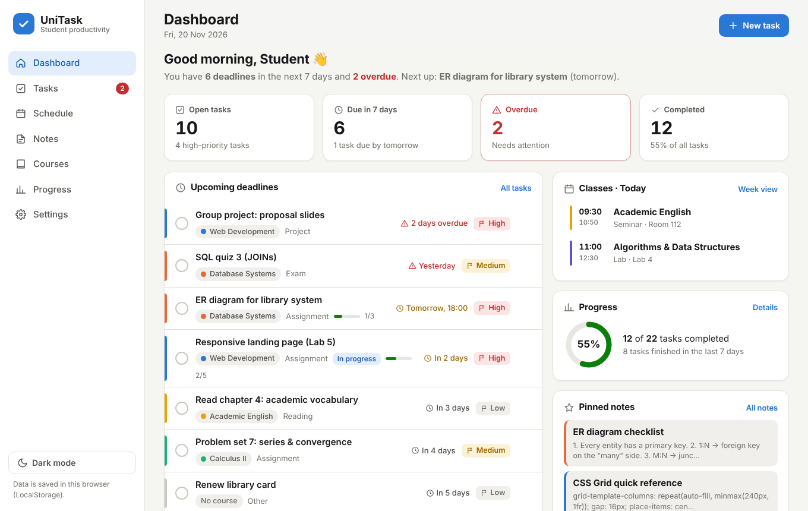

# UniTask: Student Productivity Platform

Веб-приложение для студентов университета: **задачи и дедлайны, недельное расписание пар, конспекты и статистика
прогресса** в одном месте. Демо-прототип по ТЗ группового проекта (Week 1: Topic Selection and Project Planning).

**Команда:** Ruslan (исследование и координация) · Arsen (UI/UX, Schedule, Notes) · Amirkhan (frontend, Dashboard, Tasks, хранение данных)
**Ментор:** Arslan · **Стек:** HTML, CSS, JavaScript, LocalStorage



## Запуск

Сборка и установка не нужны.

* **Вариант 1:** открыть `index.html` двойным кликом в браузере (Chrome, Edge, Firefox, Safari).
* **Вариант 2:** через локальный сервер:

  ```bash
  python3 -m http.server 8080
  ```

  Затем открыть <http://localhost:8080>.
* **Вариант 3:** один файл. `node scripts/build-single.js` создаёт `dist/unitask.html` (всё приложение в одном HTML).
* **GitHub Pages:** *Settings → Pages → Deploy from branch → / (root)*.

При первом запуске загружается демо-семестр. Сбросить или очистить его можно в **Settings**.

## Возможности

| Модуль | Функции |
|---|---|
| **Dashboard** | сводка дня, KPI-плитки, ближайшие и просроченные дедлайны, пары на сегодня, прогресс, закреплённые заметки, лента действий |
| **Tasks** | добавить, изменить, удалить, отметить выполненной; приоритет, статус, тип, дедлайн, подзадачи; вкладки, фильтры, поиск, сортировка |
| **Schedule** | сетка недели, добавление кликом по ячейке, проверка пересечений, линия «сейчас», список по дням на телефоне |
| **Notes** | конспекты с тегами, поиском и подсветкой, закрепление, привязка к курсу и задаче |
| **Courses** | предметы (цвет, код, преподаватель, кредиты) и статистика связанных данных |
| **Progress** | % выполнения, динамика за 14 дней, вовремя или с опозданием, разбивка по курсам и приоритетам |
| **Settings** | светлая / тёмная / системная тема, профиль, настройки расписания, экспорт и импорт JSON, инспектор БД |

## Документация для защиты

* [`docs/ARCHITECTURE.md`](docs/ARCHITECTURE.md): технологии, структура, слои, соответствие ТЗ, тесты
* [`docs/DATABASE.md`](docs/DATABASE.md): ER-диаграмма, таблицы, связи, ON DELETE, как модули общаются с БД
* [`docs/schema.sql`](docs/schema.sql): та же схема на SQL (PostgreSQL) + примеры запросов
* [`docs/PRESENTATION.md`](docs/PRESENTATION.md): план слайдов по участникам, сценарий демо, ответы на вопросы
* [`docs/screenshots/`](docs/screenshots): скриншоты для слайдов

## Тесты

```bash
npm test
```

9 модульных тестов слоя данных на встроенном `node:test` (Node 18+): валидация, внешние ключи, каскадное удаление,
журнал действий, экспорт и импорт, защита от XSS.

## Структура

```text
index.html               оболочка приложения
assets/css/style.css     стили, светлая и тёмная тема, адаптив
assets/js/schema.js      схема БД (таблицы, типы, FK, ON DELETE)
assets/js/db.js          слой данных над localStorage
assets/js/seed.js        демо-данные
assets/js/ui.js          модальные окна, уведомления, поля форм
assets/js/app.js         роутер, тема, запуск
assets/js/pages/*.js     страницы: dashboard, tasks, schedule, notes, courses, progress, settings
tests/                   модульные тесты
docs/                    документация и схемы
```
