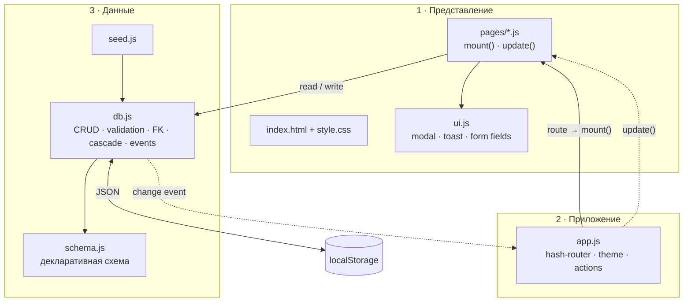

# UniTask: архитектура и технологии

## 1. Технологический стек

| Слой | Технология | Зачем и почему |
|---|---|---|
| Разметка | **HTML5** (семантические теги, `<dialog>`-подобные модальные окна, SVG-спрайт иконок) | Требование ТЗ: «HTML, CSS, JavaScript» |
| Стили | **CSS3**: Custom Properties (дизайн-токены), Grid, Flexbox, `color-mix()`, media queries | Адаптивность и светлая/тёмная тема без препроцессоров |
| Логика | **JavaScript (ES2020, vanilla)** без фреймворков и библиотек | Нет сборки, нет зависимостей, код понятен всей группе |
| Хранение | **Web Storage API → `localStorage`** + собственный реляционный слой `db.js` | Требование ТЗ: «LocalStorage will be used to keep data in the same browser» |
| Графики | **Inline SVG + CSS**, нарисованы вручную | Без Chart.js. Цвета проверены на различимость для дальтоников |
| Маршрутизация | **Hash-router** (`#/tasks`, `#/schedule` …) | SPA без сервера, работает даже при открытии `index.html` с диска |
| Тесты | **Node.js `node:test`** (встроен в Node 18+) | Модульные тесты слоя данных, без установки пакетов |
| Сборка демо | `scripts/build-single.js` | Склеивает приложение в один файл `dist/unitask.html` |
| Дизайн | **Figma** (макеты, неделя 2) | По методологии из ТЗ |
| Контроль версий | **Git + GitHub** | Совместная работа группы |

**Внешних зависимостей нет: 0 npm-пакетов в рантайме.** Приложение работает офлайн.

---

## 2. Структура проекта

```text
UniTask/
├── index.html                 # оболочка SPA: меню, шапка, контейнеры, SVG-иконки, подключение скриптов
├── assets/
│   ├── css/style.css          # дизайн-токены (light/dark), компоненты, страницы, адаптив
│   └── js/
│       ├── utils.js           # даты, время, id, экранирование HTML
│       ├── schema.js          # ОПИСАНИЕ БД: таблицы, типы, FK, ON DELETE, CHECK
│       ├── db.js              # СЛОЙ ДАННЫХ: CRUD, валидация, каскады, журнал, события, импорт/экспорт
│       ├── seed.js            # демо-семестр (даты считаются от «сегодня»)
│       ├── ui.js              # модальные окна, confirm, toast, конструкторы полей форм, бейджи
│       ├── app.js             # запуск, роутер, тема, общий «удалить с подтверждением», tooltip
│       └── pages/             # по файлу на модуль из ТЗ
│           ├── dashboard.js   # Dashboard
│           ├── tasks.js       # Tasks (+ редактор задачи с подзадачами)
│           ├── schedule.js    # Schedule (сетка недели / список на телефоне)
│           ├── notes.js       # Notes (поиск, теги, закрепление)
│           ├── courses.js     # Courses (родительская таблица)
│           ├── progress.js    # Progress (статистика и графики)
│           └── settings.js    # Settings (тема, профиль, бэкап, инспектор БД)
├── tests/db.test.js           # 9 модульных тестов слоя данных
├── scripts/build-single.js    # сборка одного HTML-файла
└── docs/                      # документация, схема БД, SQL, скриншоты, план презентации
```

---

## 3. Архитектура (слои)



**Принципы:**

1. **Разделение ответственности.** Страницы не трогают `localStorage` напрямую, только `DB`.
   Значит, хранилище можно заменить (например, на REST API) без переписывания интерфейса.
2. **Схема как данные.** Правила БД описаны объектом в `schema.js`, а `db.js` их исполняет.
   Чтобы добавить поле, достаточно одной строки в схеме.
3. **Однонаправленный поток данных.** Действие → `DB` → событие `change` → `page.update()` перерисовывает экран.
   Состояние не расходится между виджетами: счётчики, бейджи и графики всегда согласованы.
4. **Контракт страницы.** Каждая страница — объект `{ title, subtitle(), actions(), mount(view), update() }`.
   `mount` один раз вешает обработчики (делегирование событий), `update` перерисовывает данные.
5. **Без сборки.** Обычные `<script>` вместо ES-модулей, поэтому `index.html` открывается даже двойным кликом
   (у ES-модулей это не работает из-за CORS на `file://`).

---

## 4. Модули и требования ТЗ

| Модуль из ТЗ (раздел 7) | Что реализовано | Файл |
|---|---|---|
| **Dashboard**: обзор задач, выполненного, ближайших дедлайнов | приветствие и сводка; 4 KPI-плитки (открытые, на 7 дней, просрочено, выполнено); список ближайших дедлайнов с отметкой «выполнено» прямо здесь; пары на сегодня с индикатором «now»; кольцо прогресса; закреплённые заметки; лента последних действий | `dashboard.js` |
| **Tasks**: add, edit, delete, complete, prioritize, filter | CRUD; подзадачи-чек-лист; приоритет (High/Medium/Low); статус (To do / In progress / Done); тип; дедлайн с датой и временем; оценка часов; вкладки *Open / Due today / This week / Overdue / Completed / All*; фильтры по курсу и приоритету; поиск; 4 вида сортировки; группировка по срочности | `tasks.js` |
| **Schedule**: недельные пары, время, аудитории | сетка недели (Пн–Пт или Пн–Вс), клик по пустой ячейке создаёт пару; линия «сейчас»; тип пары (лекция, практика, лаба, семинар); проверка пересечений; часы в неделю по курсам; на телефоне список по дням | `schedule.js` |
| **Notes**: create, edit, delete, search | CRUD; поиск с подсветкой; фильтр по курсу; облако тегов; закрепление на главной; привязка к курсу и к задаче | `notes.js` |
| **Progress**: статистика выполнения | % выполнения; выполнено за 7 дней в сравнении с прошлой неделей; доля сданных вовремя; оставшиеся часы; столбчатый график по дням (14 дней) с подсказками и табличным видом; разбивка по статусу, приоритету и курсу | `progress.js` |
| **Settings**: настройки, светлая/тёмная тема | тема Light / Dark / System; имя; границы учебного дня; выходные в расписании; горизонт «ближайших» дедлайнов; подтверждение удаления; экспорт и импорт JSON; сброс демо-данных; **инспектор БД** и проверка целостности | `settings.js` |
| *(доп.)* **Courses** | справочник предметов (цвет, код, преподаватель, кредиты) со статистикой связанных задач, пар и заметок | `courses.js` |

---

## 5. Качество и нефункциональные требования

| Требование | Как обеспечено |
|---|---|
| **Адаптивность** (ТЗ: *clear, responsive*) | Брейкпоинты 640 / 760 / 960 px; на телефоне меню выезжает сбоку, формы открываются снизу, расписание показано списком; без горизонтальной прокрутки при 390 px |
| **Тёмная тема** | Два набора CSS-переменных; тема применяется до первой отрисовки, без «вспышки»; режим *System* следует настройке ОС |
| **Безопасность (XSS)** | Весь пользовательский текст проходит через `U.esc()` перед вставкой в HTML (есть тест; проверено вводом `<b>xss</b>`) |
| **Целостность данных** | Валидация, FK, каскады, атомарный импорт, `integrityCheck()` |
| **Устойчивость** | Если `localStorage` заблокирован (приватный режим, песочница), приложение работает в памяти и предупреждает пользователя; повреждённый JSON не роняет приложение |
| **Доступность (a11y)** | Семантические кнопки и ссылки, `aria-label`, `aria-current`, видимый фокус, Esc закрывает окна, статус не передаётся только цветом (иконка и текст), `prefers-reduced-motion` |
| **Производительность** | Данные читаются из кэша в памяти; JSON разбирается один раз при старте; делегирование событий |
| **Удобство** | Горячая клавиша **N** создаёт запись на текущей странице; демо-данные при первом запуске; уведомления-тосты |

---

## 6. Тестирование

```bash
npm test          # = node --test tests/*.test.js
```

| № | Тест | Что доказывает |
|---|---|---|
| 1 | first run seeds demo data… | демо-данные создаются и целостны |
| 2 | data persists in localStorage… | данные переживают перезагрузку |
| 3 | validation… | NOT NULL, enum, форматы, CHECK `end > start` |
| 4 | foreign keys must point to existing rows | FK-ограничение |
| 5 | deleting a course… | CASCADE для пар, SET NULL для задач и заметок |
| 6 | deleting a task cascades… | CASCADE для подзадач |
| 7 | completing and reopening… | `completedAt` и журнал действий |
| 8 | export → import round-trip… | бэкап сохраняет id и связи; импорт атомарный |
| 9 | HTML escaping… | защита от XSS |

Дополнительно вручную и через Playwright проверены сценарии в Chromium: создание задачи, валидация,
отметка выполнения, пересечение пар, каскадное удаление курса, поиск заметок, сохранение после перезагрузки,
тёмная тема, мобильная вёрстка (iPhone 13). Ошибок в консоли нет.

---

## 7. Ограничения прототипа и развитие (v2)

* Данные живут в одном браузере и не синхронизируются. Для переноса есть экспорт и импорт JSON.
* Нет аккаунтов и совместной работы (вне рамок ТЗ).
* Для v2: бэкенд на Node.js (Express) и PostgreSQL по `docs/schema.sql`, авторизация, PWA с офлайн-кэшем,
  уведомления о дедлайнах (Notification API), импорт расписания из университетской системы (iCal).
