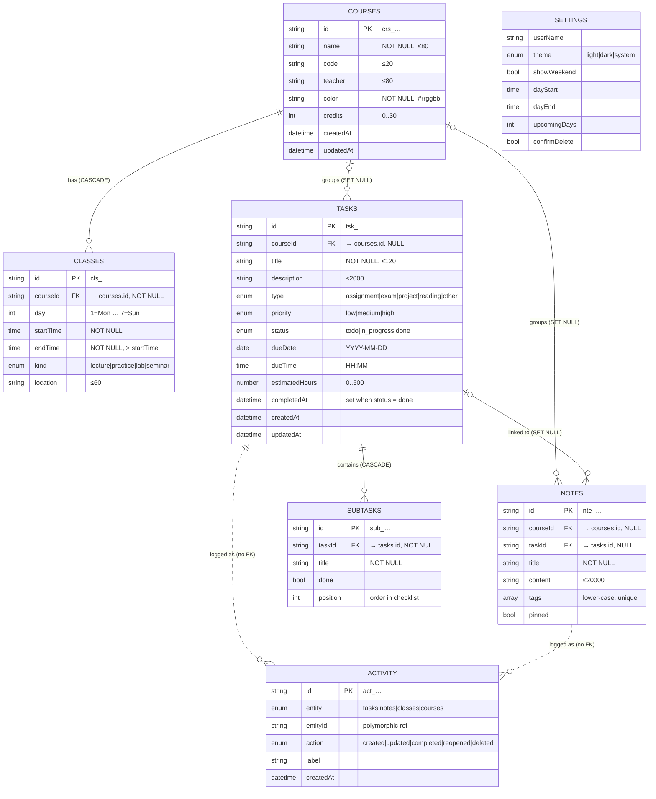
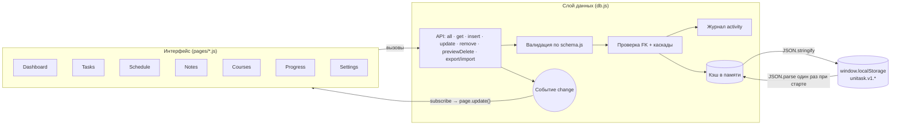
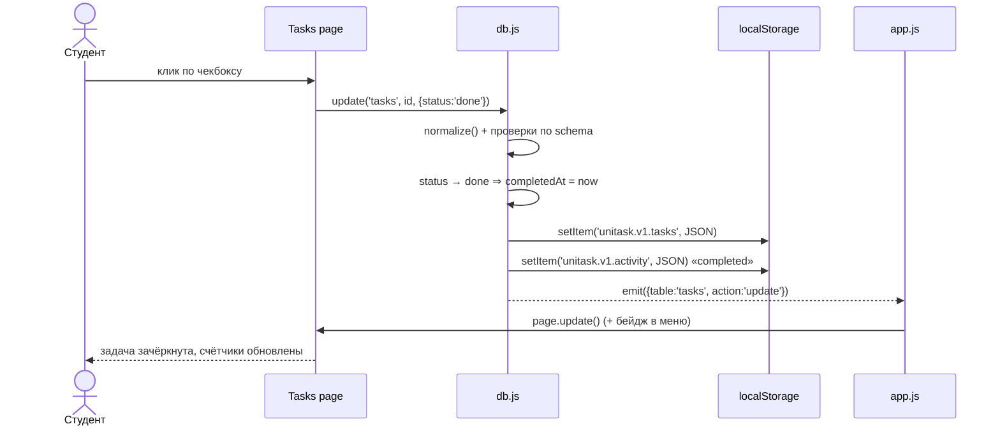
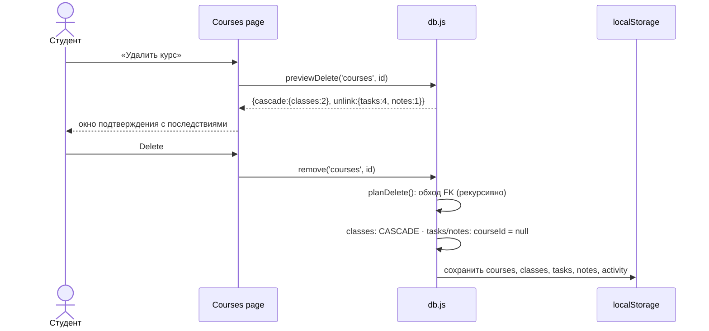

# UniTask: база данных

По ТЗ (раздел 4, *Initial project scope*) данные хранятся **в браузере, в LocalStorage**, без сервера.
Сам LocalStorage умеет только одно: хранить пары «ключ → строка». Поверх него мы написали небольшой
**реляционный слой** (`assets/js/db.js`). В нём есть таблицы, первичные и внешние ключи, проверки данных и каскадное
удаление, то есть всё то же, что в настоящей СУБД. Схема описана декларативно в `assets/js/schema.js`.
Её эквивалент на SQL лежит в [`schema.sql`](schema.sql).

---

## 1. ER-диаграмма



> GitHub отрисует диаграмму сам. Для слайдов её можно открыть в <https://mermaid.live>
> и экспортировать в PNG или SVG.

---

## 2. Таблицы и связи

| Таблица | Ключ в LocalStorage | Назначение | Связи |
|---|---|---|---|
| `courses` | `unitask.v1.courses` | Предметы студента. Центральная («родительская») таблица | 1 → N `classes`, `tasks`, `notes` |
| `tasks` | `unitask.v1.tasks` | Задания, экзамены, проекты | N → 1 `courses` (необязательно), 1 → N `subtasks`, `notes` |
| `subtasks` | `unitask.v1.subtasks` | Чек-лист внутри задачи | N → 1 `tasks` (обязательно) |
| `classes` | `unitask.v1.classes` | Пары в недельном расписании | N → 1 `courses` (обязательно) |
| `notes` | `unitask.v1.notes` | Конспекты | N → 1 `courses`, N → 1 `tasks` (обе необязательны) |
| `activity` | `unitask.v1.activity` | Журнал действий (лента «Recent activity») | Логическая ссылка `entity + entityId`, без FK |
| `settings` | `unitask.v1.settings` | Настройки, одна запись (singleton) | — |
| `meta` | `unitask.v1.meta` | Версия схемы и дата создания базы | — |

### Типы связей

* **1 : N обязательная.** Курс → пары (`classes.courseId NOT NULL`), задача → подзадачи (`subtasks.taskId NOT NULL`).
  Без родителя такая строка не имеет смысла.
* **1 : N необязательная (0..1 : N).** Курс → задачи и заметки, задача → заметки. Задача «Продлить читательский билет»
  может существовать без курса.
* **Полиморфная ссылка.** `activity.entity + activity.entityId` может указывать на строку любой таблицы.
  FK здесь намеренно нет: запись в журнале должна пережить удаление самой сущности.
* **M : N отсутствует.** Теги хранятся массивом внутри заметки. При переходе на SQL их стоит вынести в таблицы
  `tags` и `note_tags` (это есть в `schema.sql` как задел на будущее).

### Правила удаления (ON DELETE)

| Удаляем… | Что происходит со связанными строками |
|---|---|
| курс | `classes` этого курса **удаляются** (CASCADE); `tasks` и `notes` **остаются**, но `courseId = null` (SET NULL) |
| задачу | её `subtasks` **удаляются** (CASCADE); у `notes` обнуляется `taskId` (SET NULL) |
| подзадачу, пару или заметку | ничего, зависимых строк нет |

Перед удалением приложение вызывает `DB.previewDelete()` и показывает пользователю, что именно произойдёт
(скриншот `screenshots/cascade-delete.png`): «2 classes will also be deleted · 4 tasks will be kept but unlinked».

---

## 3. Ограничения целостности (как в СУБД)

| Ограничение | Где проверяется | Пример ошибки |
|---|---|---|
| PRIMARY KEY, уникальный | `DB.insert()` генерирует `prefix_` + время + random | `Duplicate primary key …` |
| NOT NULL | поле `required: true` | `Title is required` |
| Типы и форматы | `date` = `YYYY-MM-DD`, `time` = `HH:MM`, `color` = `#rrggbb`, `int`, `number`, `bool` | `DueDate has an invalid date format` |
| CHECK (enum) | `priority ∈ {low, medium, high}` и т. д. | `Priority must be one of: …` |
| CHECK (диапазон и длина) | `max`, `min` | `Credits must be ≤ 30` |
| CHECK на уровне строки | `classes.check()`: `endTime > startTime` | `End time must be after start time` |
| FOREIGN KEY | тип `ref`: родитель обязан существовать | `Linked course does not exist (foreign key tasks.courseId → courses.id)` |
| Бизнес-правило | пары в один день не пересекаются (`schedule.js`) | `Overlaps with Web Development (09:00–10:30)` |
| Атомарный импорт | `DB.importData()` при любой ошибке возвращает снимок | `import is all-or-nothing` (см. тест) |

Неизвестные поля молча отбрасываются, поэтому в базу не попадает «мусор».
Проверка целостности (`DB.integrityCheck()`) ищет «висячие» внешние ключи. Её можно запустить кнопкой
**Settings → Check integrity**.

---

## 4. Как модули «общаются» с базой



1. При старте `DB.init()` один раз читает все ключи `unitask.v1.*`, разбирает JSON и складывает в кэш в памяти.
   При первом запуске создаётся демо-семестр (`seed.js`).
2. Страницы **читают** данные только через `DB.all()` / `DB.get()` / `DB.index()` из кэша, это быстро.
3. Страницы **пишут** только через `DB.insert / update / remove`. Слой данных проверяет запись, сохраняет
   изменённую таблицу в LocalStorage и рассылает событие `change`.
4. `app.js` подписан на событие и перерисовывает текущую страницу. Поэтому, например, отмеченная на главной
   задача сразу меняет счётчики, бейдж «просрочено» в меню и графики.

### Сценарий: студент отмечает задачу выполненной



### Сценарий: удаление курса (каскад)



---

## 5. Как это выглядит внутри LocalStorage

Откройте DevTools → *Application* → *Local Storage*. Ещё удобнее страница **Settings → Database inspector**
прямо в приложении.

```text
unitask.v1.meta       {"schemaVersion":1,"createdAt":"2026-11-20T07:21:00.000Z"}
unitask.v1.settings   {"userName":"Student","theme":"system","showWeekend":false,…}
unitask.v1.courses    [{"id":"crs_mwony2b8uaax7l","name":"Database Systems","color":"#eb6834",…}, …]
unitask.v1.tasks      [{"id":"tsk_mwony2bbn2kv7j","courseId":"crs_mwony2b8uaax7l","title":"ER diagram…",
                        "priority":"high","status":"todo","dueDate":"2026-11-21",…}, …]
unitask.v1.subtasks   [{"id":"sub_…","taskId":"tsk_mwony2bbn2kv7j","title":"Draw relationships","done":false,…}]
unitask.v1.classes    [{"id":"cls_…","courseId":"crs_…","day":2,"startTime":"09:00","endTime":"10:30",…}]
unitask.v1.notes      [{"id":"nte_…","courseId":"crs_…","taskId":"tsk_…","tags":["erd","exam"],…}]
unitask.v1.activity   [{"id":"act_…","entity":"tasks","entityId":"tsk_…","action":"completed",…}]
```

* Формат хранения: **JSON-массив строк на каждую таблицу**. Связи хранятся как строковые id.
* Объём демо-данных около 35 КБ при лимите LocalStorage около 5 МБ на сайт. Этого хватит на тысячи задач.
* Резервная копия: **Settings → Export JSON** (файл `unitask-backup-YYYY-MM-DD.json`), восстановление через **Import JSON**.
* Миграции: в `meta.schemaVersion` хранится версия. При изменении схемы `DB.migrate()` обновит старые данные.

---

## 6. Почему не настоящая СУБД

По ТЗ первая версия должна быть чисто фронтенд-прототипом без регистрации и облака. Слой `db.js` сделан так,
чтобы его можно было заменить: страницы не знают, что под ними LocalStorage. Для версии 2 достаточно переписать
`db.js` на `fetch()` к REST API (Node.js + PostgreSQL по `schema.sql`), и интерфейс останется прежним.

| | LocalStorage (сейчас) | PostgreSQL (план) |
|---|---|---|
| Где данные | в браузере пользователя | на сервере |
| Синхронизация между устройствами | нет | да |
| Нужна регистрация | нет | да (таблица `users`, `user_id` во всех таблицах) |
| Работа офлайн | да | только с кэшем |
| Целостность | наш слой `db.js` | средствами СУБД (FK, CHECK) |
